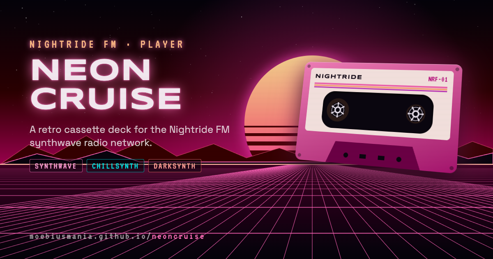

# Neon Cruise



A retro outrun cassette player for the [Nightride FM](https://nightride.fm) synthwave radio network, built with [Astro](https://astro.build), [Preact](https://preactjs.com) and [Bun](https://bun.sh).

**Live:** https://moebiusmania.github.io/neoncruise/

## Features

- Live 320 kbps streams for the seven Nightride FM stations, each with its own color world
- Now-playing info, listener counts and a recently played log, updated live
- Animated outrun scene and spectrum that react to the music
- Phone layout with Now Playing, Tape Shelf and Signal FX screens; a three-pane desktop layout on wider screens
- CRT effects (scanlines, flicker, noise), optional tape hiss and a sleep timer that fades out
- Lock-screen and media key controls, keyboard shortcuts
- Installable as an app (PWA)

## Getting started

You need [Bun](https://bun.sh) 1.4 or newer.

```sh
bun install
bun run dev
```

Then open http://localhost:4321/neoncruise/.

| Command           | What it does                                      |
| ----------------- | ------------------------------------------------- |
| `bun run dev`     | Start the dev server with hot reload              |
| `bun run build`   | Build the static site into `dist/`                |
| `bun run preview` | Serve the production build locally                |
| `bun run icons`   | Regenerate the PNG app icons from `public/icons/icon.svg` |

The offline service worker only registers in production builds, so use `bun run build && bun run preview` to test installing the app.

## Keyboard shortcuts

| Key             | Action           |
| --------------- | ---------------- |
| `Space` / `K`   | Play / pause     |
| `←` `→`         | Previous / next station |
| `1`–`7`         | Jump to a station |
| `M`             | Mute             |
| `F`             | Open Signal FX   |

## Deployment

Every push to `main` builds the site and deploys it to GitHub Pages through [`.github/workflows/deploy.yml`](.github/workflows/deploy.yml). The site is served under `/neoncruise/`, set by `base` in [`astro.config.mjs`](astro.config.mjs).

## Credits

Music, streams and track data come from [Nightride FM](https://nightride.fm). This is an unofficial fan-made player and isn't affiliated with Nightride FM. If you enjoy the stations, consider [supporting them](https://nightride.fm).

## License

[MIT](LICENSE)
